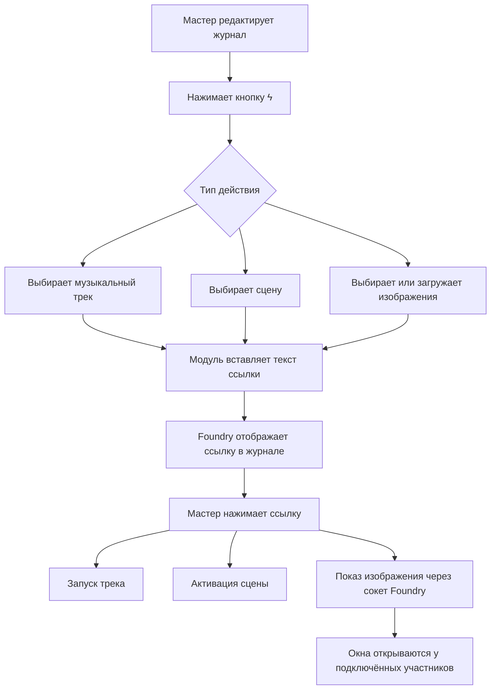

# Journal Media Links


**Journal Media Links** — модуль для Foundry Virtual Tabletop, который добавляет в текстовые журналы кликабельные действия для Мастера: запуск отдельного музыкального трека, активацию сцены и одновременный показ одного или нескольких изображений игрокам.

> Главная идея: подготовить ссылки прямо в тексте приключения и во время игры запускать нужные действия одним нажатием, не переключаясь между журналом, плейлистами и списком сцен.

## Возможности

| Возможность | Что делает |
|---|---|
| **Музыкальный трек** | Запускает выбранный трек из конкретного плейлиста, а не плейлист целиком. |
| **Активация сцены** | Делает выбранную сцену активной в Foundry. |
| **Показ изображений** | Открывает изображение или галерею изображений поверх интерфейса Foundry на клиентах участников. |
| **Окно галереи** | Позволяет перемещать и изменять размер окна; изображения масштабируются с сохранением пропорций. |
| **Управление закрытием** | Каждый участник может закрыть окно у себя; Мастер может закрыть его у всех. |
| **Инструменты редактора** | Добавляет кнопку `ϟ` в редактор журнала для создания ссылок через диалог. |
| **Загрузка изображений** | Позволяет загрузить новые изображения из диалога создания ссылки. |

## Как это работает



Ссылки хранятся непосредственно в тексте журнала. При отображении текста модуль преобразует специальный синтаксис в кликабельные элементы. Выполнять действия может только Мастер.

## Установка

1. Скачайте или скопируйте папку `journal-media-links` целиком.
2. Поместите её в каталог модулей Foundry:

   ```text
   Data/modules/journal-media-links/
   ```

3. Проверьте, что файл `module.json` находится непосредственно внутри папки `journal-media-links`, а не во вложенной папке с таким же названием.
4. Перезапустите Foundry VTT или сервер.
5. Откройте настройки нужного мира → **Управление модулями** и включите **Journal Media Links**.
6. Заново откройте журнал или обновите страницу клиента, если кнопка редактора не появилась.

**Совместимость:** модуль заявлен для Foundry VTT v13. Дополнительные модули для его основных функций не требуются.

## Быстрый старт

### 1. Создание ссылки

1. Откройте журнал и включите режим редактирования.
2. Нажмите новую кнопку `ϟ` на панели редактора.
3. Выберите тип ссылки: сцену, музыкальный трек или изображения.
4. Укажите нужный объект и задайте текст ссылки.
5. Нажмите **«Вставить в редактор»** и сохраните журнал.
6. Во время игры нажмите созданную ссылку от имени Мастера.

### 2. Запуск музыкального трека

В диалоге выберите плейлист, затем конкретный трек. Модуль вставит ссылку, использующую внутренние ID Foundry. При нажатии запускается именно выбранный трек.

### 3. Активация сцены

Выберите сцену в диалоге. После нажатия ссылки сцена становится активной. Само наличие ссылки в журнале не активирует сцену автоматически.

### 4. Показ изображений игрокам

1. В диалоге выберите тип **«Показ изображений игрокам»**.
2. Выберите один или несколько файлов из списка.
3. Чтобы добавить файлы, воспользуйтесь полем загрузки и кнопкой загрузки.
4. Выделите нужные изображения в списке и вставьте ссылку в журнал.
5. Нажмите ссылку во время игры. Модуль откроет окно у Мастера и отправит команду показа подключённым клиентам.

Изображения загружаются в каталог данных текущего мира:

```text
Data/worlds/<world-id>/assets/journal-media-links/
```

Поддерживаемые расширения: `png`, `jpg`, `jpeg`, `webp`, `gif`, `avif`, `bmp`.

## Синтаксис ссылок

Обычно ссылки стоит создавать кнопкой `ϟ`. Ручное редактирование полезно для переноса готового журнала или массового создания ссылок.

### Музыка

```text
@PlayTrack[Playlist.<PLAYLIST_ID>.PlaylistSound.<SOUND_ID>]{Включить музыку}
```

Пример структуры ссылки:

```text
@PlayTrack[Playlist.a1b2c3.PlaylistSound.d4e5f6]{Музыка таверны}
```

`<PLAYLIST_ID>` и `<SOUND_ID>` — внутренние ID Foundry, а не названия плейлиста и трека.

### Сцена

```text
@ActivateScene[Scene.<SCENE_ID>]{Открыть сцену}
```

Пример:

```text
@ActivateScene[Scene.g7h8i9]{Показать столицу}
```

### Изображения

```text
@ShowImages[<ENCODED_PATH_1>|<ENCODED_PATH_2>]{Показать изображения}
```

Пути разделяются символом `|`. Каждый путь должен быть URL-кодирован отдельно. Диалог модуля делает это автоматически, поэтому вручную кодировать путь обычно не требуется.

## Управление окном изображений

- **Перемещение:** перетащите окно за заголовок.
- **Изменение размера:** потяните за край или угол окна, если это поддерживает используемый браузер.
- **Закрыть у себя:** закрывает окно только у текущего участника.
- **Закрыть у всех:** кнопка доступна Мастеру и отправляет команду закрытия всем подключённым клиентам.

Повторный запуск ссылки на изображения заменяет текущее окно новым набором изображений.

## Права доступа и поведение

- Создавать ссылки через кнопку `ϟ` и запускать их может Мастер.
- Игрокам необходим доступ к самому журналу, чтобы читать его содержимое.
- Для показа изображений у игроков модуль должен быть включён у подключённых клиентов, а файлы должны быть доступны клиентам через сервер Foundry.
- Запуск музыки и сцены выполняется на стороне Мастера. Дальнейшее поведение звука зависит от штатных настроек плейлиста и прав Foundry.
- В `module.json` включена поддержка сокета (`"socket": true`), используемого для общей демонстрации и закрытия изображений.

## Структура проекта

```text
journal-media-links/
├── module.json
├── README.md
└── scripts/
    ├── main.js                 # Точка входа и регистрация подсистем
    ├── constants.js             # Общие константы и путь к папке изображений
    ├── links/
    │   ├── enrichers.js         # Преобразование синтаксиса в кликабельные ссылки
    │   └── link-handler.js      # Обработка нажатий на ссылки
    ├── images/
    │   └── image-overlay.js     # Окно изображений и сокетные сообщения
    ├── editor/
    │   ├── editor-button.js     # Кнопка ϟ в редакторе журнала
    │   └── link-dialog.js       # Диалог выбора трека, сцены и изображений
    └── utils/
        └── html.js              # Вспомогательная HTML-экранизация
```

### Назначение основных файлов

| Файл | Ответственность |
|---|---|
| `main.js` | Подключает обработчики на этапах `init` и `ready`. |
| `constants.js` | Хранит ID модуля, имя сокета, подписи и путь к изображениям. |
| `links/enrichers.js` | Распознаёт `@PlayTrack`, `@ActivateScene` и `@ShowImages`. |
| `links/link-handler.js` | Проверяет права и вызывает соответствующее действие при клике. |
| `images/image-overlay.js` | Создаёт окно, размещает изображения и обрабатывает команды через сокет. |
| `editor/editor-button.js` | Добавляет кнопку `ϟ` в интерфейс текстового редактора. |
| `editor/link-dialog.js` | Создаёт диалог, заполняет списки и обрабатывает загрузку изображений. |
| `utils/html.js` | Содержит общую функцию безопасного экранирования текста для HTML. |

## Устранение неполадок

<details>
<summary><strong>Кнопка ϟ не отображается</strong></summary>

- Убедитесь, что модуль включён в текущем мире и вы вошли как Мастер.
- Проверьте, что модуль установлен в `Data/modules/journal-media-links/`.
- Перезапустите Foundry и повторно откройте редактор журнала.
- Откройте консоль браузера (`F12`) и проверьте сообщения об ошибках.

</details>

<details>
<summary><strong>Ссылка отображается обычным текстом</strong></summary>

- Проверьте написание синтаксиса и соответствие парных символов `[]` и `{}`.
- Сохраните журнал и откройте его в режиме просмотра.
- Убедитесь, что модуль успешно загрузился; в консоли должно появиться сообщение `Journal Media Links | Ready`.

</details>

<details>
<summary><strong>Не запускается трек или не активируется сцена</strong></summary>

- Создайте ссылку через кнопку `ϟ`, чтобы использовать корректные внутренние ID.
- Проверьте, что выбранный трек всё ещё существует в выбранном плейлисте или что сцена не была удалена.
- Изучите ошибки `Journal Media Links` в консоли браузера Мастера.

</details>

<details>
<summary><strong>Игроки не видят изображения</strong></summary>

- Проверьте, что модуль включён в этом мире и у игроков.
- Убедитесь, что в `module.json` присутствует `"socket": true`.
- Перезапустите сервер Foundry и переподключите клиентов после изменения `module.json`.
- Убедитесь, что файлы реально существуют в `Data/worlds/<world-id>/assets/journal-media-links/` и доступны клиентам.
- В консоли браузера игрока проверьте сообщения `Journal Media Links` и ошибки загрузки изображений.

</details>

## Разработка и изменение кода

Модуль использует стандартные ES-модули JavaScript Foundry. Сборка не требуется: при добавлении нового файла импортируйте его из соответствующего модуля и убедитесь, что путь и регистр букв в `import` совпадают с именем файла.

При изменении кода:

1. Сохраните изменённые файлы в папке модуля.
2. Выполните полную перезагрузку клиента Foundry; при изменениях манифеста или загрузки модулей перезапустите сервер.
3. Проверьте консоль браузера Мастера и тестового игрока.
4. Отдельно проверьте запуск музыки, активацию сцены, показ нескольких изображений и команду **«Закрыть у всех»**.

## Технические сведения

- **ID модуля:** `journal-media-links`
- **Версия:** `1.0.0`
- **Заявленная совместимость:** Foundry VTT v13
- **Точка входа:** `scripts/main.js`
- **Подключение:** `esmodules`
- **Внешние зависимости:** не требуются для основных функций

---

*Подготовлено для ведения сцен и повествования непосредственно из журналов Foundry VTT.*

